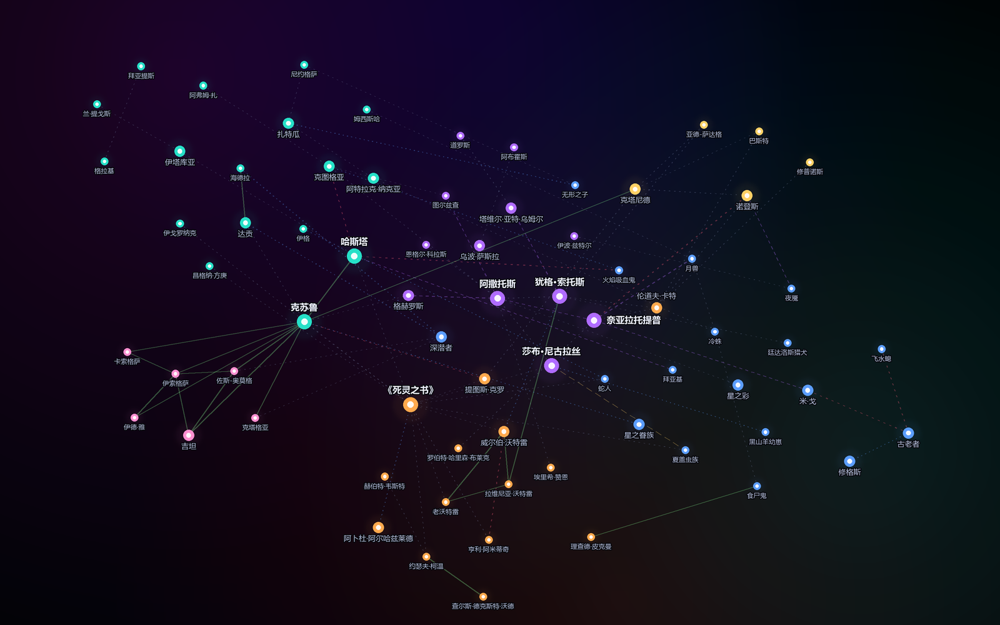

# 克苏鲁神话 · 星图 | Cthulhu Mythos Star Chart

一张可交互的克苏鲁神话人物关系星图：72 个实体、96 条关系，按 6 大阵营聚成星区，每个实体都有一句介绍，每条关系都标了类型、叫法和一句说明。

## 直接打开

双击 `index.html` 即可。单文件、零依赖、不需要联网 —— 没有外部字体、没有 CDN、没有任何脚本请求。

## 功能

| 操作 | 效果 |
|---|---|
| 点击星辰 | 右侧展开面板：英文名、称谓、介绍、全部关系（点关系可跳到对方） |
| 悬停 | 高亮该星点相关的连线与邻居 |
| 滚轮 | 以光标为中心缩放（0.16×–3.2×） |
| 拖背景 / 拖节点 | 平移；拖节点会重新收敛布局 |
| 搜索框 | 中英文名实时筛选 |
| 图例 | 点阵营开合显示；每种关系线带条数 |
| 关系总表 | 96 条关系的可筛选全表（按类型/阵营） |
| 阵营统计 | 各阵营成员数、内部与跨阵营关系数 |
| 重排 | 换一个随机种子重新推演一版布局 |
| Esc | 关面板 / 关弹层 |

## 数据规模

**6 大阵营 · 72 个实体**

| 阵营 | 人数 | 代表 |
|---|---|---|
| 外神 Outer Gods | 12 | 阿撒托斯、犹格·索托斯、奈亚拉托提普、莎布·尼古拉丝 |
| 旧日支配者 Great Old Ones | 17 | 克苏鲁、哈斯塔、克图格亚、达贡、扎特瓜、伊格 |
| 旧神 Elder Gods | 5 | 诺登斯、克塔尼德、亚德-萨达格、巴斯特、修普诺斯 |
| 克苏鲁血系 | 6 | 吉坦、伊索格萨、卡索格萨、佐斯·奥莫格 |
| 神话种族 | 18 | 深潜者、米·戈、古老者、修格斯、星之彩、夜魇 |
| 人类与典籍 | 14 | 《死灵之书》、伦道夫·卡特、老沃特雷、阿米蒂奇 |

**6 类关系 · 96 条**

| 类型 | 条数 | 含义 | 例子 |
|---|---|---|---|
| 血缘 kin | 20 | 同族/亲子 | 克塔尼德 ↔ 克苏鲁「兄弟」 |
| 从属 serve | 8 | 侍奉/统辖 | 奈亚拉托提普 → 夜魇 |
| 造物 created | 10 | 造物/受造 | 克苏鲁 → 星之眷族 |
| 崇拜 worship | 1 | 信仰/献祭 | 夏盖虫族 → 莎布·尼古拉丝 |
| 敌对 enemy | 7 | 对抗 | 哈斯塔 ↔ 克图格亚「风与火」 |
| 关联 other | 50 | 同盟、囚禁、同源、提及等 | 伦道夫·卡特 → 《死灵之书》 |

## 实现说明

- **布局**：确定性力导向。斥力 `REP=34000`、弹簧 `SPRING=0.035`、阻尼 `0.855`、阵营锚点 `ANCHOR_K=0.055`；随机种子固定 `20240617`，所以每次打开都是同一张图。
- **标签**：`placeLabels()` 给每个星点在 12 个候选位里贪心择位，代价函数同时惩罚压住别的标签和压住别的星核；实测重叠 0。缩放时按重要度分级隐藏（`k<0.7` 隐小字、`k<0.46` 隐中字）。
- **自适应**：`fit()` 包住标签盒与星核的包围盒，为固定顶栏留位。初始 `k≈0.912`，72 个标签默认全可见。
- **渲染**：单张 SVG + 一张 canvas 星空背景（星云、亮星十字星芒）。玻璃拟态面板。

## 关于数据

人物与关系依据 H.P. 洛夫克拉夫特原作及德雷斯、布洛克、朗、卡特等后继作者的作品整理，属于二次整理的民间设定汇编：不同版本的「神话」在细节上并不一致（比如旧神与旧日支配者的从属关系），本图取常见说法，不宣称官方权威。

## License

代码与页面：MIT。文字整理部分建议按 CC BY 4.0 使用。
